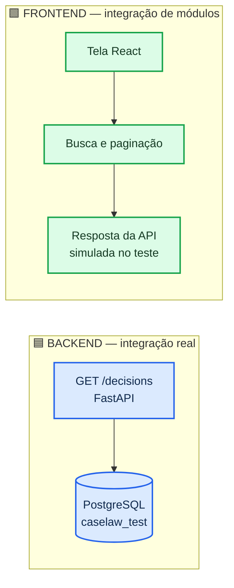
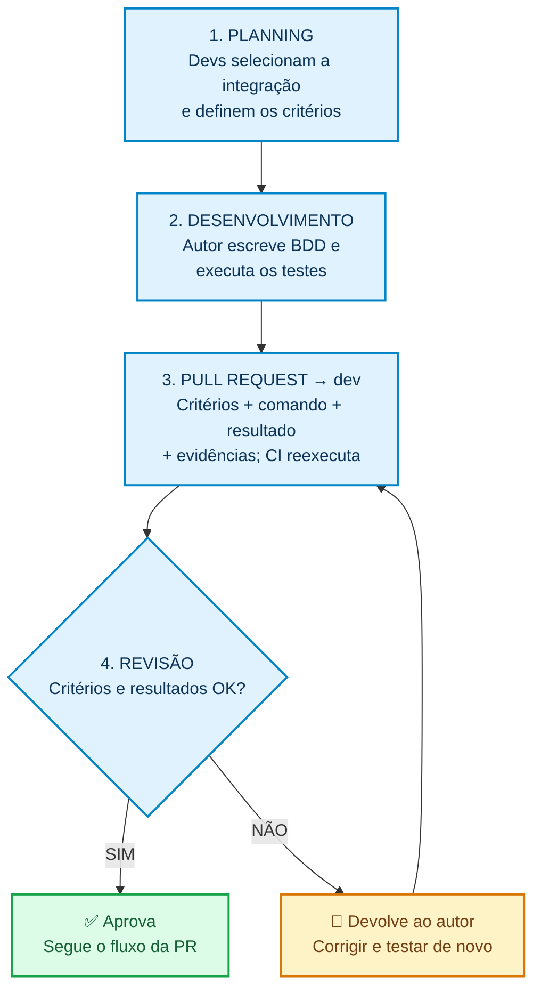

# 🧭 Guia visual — Testes de integração no Case-Law

> **Validação com o professor — 05/11/2026:** apresentar um **padrão mínimo e verificável** de testes de integração para o Case-Law, usando testes que já existem no código. **Não confundir teste de integração com teste unitário nem com teste ponta a ponta.**
>
> **Como apresentar:** mostre a seção ①, acompanhe o fluxograma ②, leia os dois critérios ③ e encerre com a pergunta ⑤.

## ① O que chamamos de “unidade de integração”?

| 🟦 BACKEND | 🟩 FRONTEND |
| :---: | :---: |
| **API FastAPI ↔ PostgreSQL real de teste** | **Tela React ↔ lógica de busca e paginação** |
| O banco é real, mas separado da aplicação de produção | A API é **simulada**: estamos testando os módulos do frontend juntos |
| **Exemplo:** filtrar decisões pelo tribunal STJ | **Exemplo:** mostrar os resultados e a paginação corretos |

**Resposta para “qual é a unidade?”** No teste de integração, nossa unidade de verificação é **uma interação delimitada entre partes do sistema**; não apenas uma classe.

## ② Padrão que os desenvolvedores devem seguir

**Quando?** Durante o desenvolvimento e antes de aprovar a PR. Se o autor corrigir algo, reexecuta e anexa nova evidência.

**Regra mínima proposta:** exigir novos testes de integração quando a alteração afetar a comunicação entre partes do sistema; se não afetar, justificar brevemente na PR. A decisão do professor sobre esse gatilho ainda será registrada.

## ③ Critérios BDD concretos (do próprio Case-Law)

### 🟦 Backend — API + PostgreSQL

> **DADO** um banco de teste com decisões de diferentes tribunais.  
> **QUANDO** a API busca **“dano moral”**, filtrando **STJ**.  
> **ENTÃO** retorna **HTTP 200**, **total = 2** e somente as decisões **2000001** e **2000002**, ambas do STJ.

🧪 Teste existente: [`test_one_court_returns_only_its_decisions`](https://github.com/pablohgs05/Case-Law/blob/dev/backend/tests/test_search_filters.py). Usa `TestClient` e PostgreSQL real `caselaw_test`, com dados controlados.

### 🟩 Frontend — Tela + pesquisa e paginação

> **DADO** uma resposta **simulada** da API com **45 resultados**.  
> **QUANDO** o usuário clica em **Pesquisar**.  
> **ENTÃO** aparecem **6 cartões** e o texto **“Exibindo 1–6 de 45 resultados”**.

🧪 Teste existente: [`on the first page of 45 ...`](https://github.com/pablohgs05/Case-Law/blob/dev/frontend/src/tests/resultsPagination.test.tsx). Usa React Testing Library e Vitest; **não** sobe o backend.

## ④ Evidências que podem ser abertas na hora

| O que mostrar | Evidência concreta |
| :--- | :--- |
| 🟦 Backend — API + PostgreSQL | [`test_one_court_returns_only_its_decisions`](https://github.com/pablohgs05/Case-Law/blob/dev/backend/tests/test_search_filters.py): a chamada usa `TestClient` e conexão PostgreSQL real de teste, com dados controlados; valida tribunal STJ, total e identificadores |
| 🟩 Frontend — tela + busca/paginação | [`resultsPagination.test.tsx`](https://github.com/pablohgs05/Case-Law/blob/dev/frontend/src/tests/resultsPagination.test.tsx): 45 resultados simulados → 6 cartões e `Exibindo 1–6 de 45 resultados` |
| ✅ CI recente da contribuição de sincronização | [Execução de 05/11/2026 — PR #8](https://github.com/pablohgs05/Case-Law/actions/runs/42038759505), backend e frontend aprovados |
| 🔁 Execução na `dev` após merge | [CI do merge de 05/11/2026](https://github.com/pablohgs05/Case-Law/actions/runs/42039148107); verificar estado mais recente no GitHub antes de apresentar |

Os resultados da suíte completa **não** são quantidades de testes de integração. O PostgreSQL utilizado no CI é `caselaw_test` e **não** o banco de produção. A API simulada do frontend permite testar a integração de módulos de interface, mas **não** prova comunicação ponta a ponta com o backend.

## ⑤ Fala pronta — aproximadamente 50 segundos 🎤

> **Professor, nossa proposta é que os testes de integração sigam um padrão simples da equipe.**  
> Na planning, os desenvolvedores identificam qual integração será afetada e definem os critérios. Durante o desenvolvimento, o autor implementa cenários Dado, Quando e Então e executa os testes. Depois registra os resultados na PR. O revisor confere: se estiver correto, segue; se não, devolve para correção e nova execução.  
> No Case-Law temos exemplos reais nos dois lados: **a API integrada ao PostgreSQL** no backend e **a tela integrada à lógica de busca e paginação** no frontend. Esses testes existem no projeto, e o CI executa os exemplos técnicos.  
> **Podemos validar as quatro etapas, as duas integrações escolhidas e o critério de quando um teste novo é obrigatório como padrão mínimo do time?**

<strong>🙋 Se o professor interromper — respostas de 1 frase</strong>

| Pergunta | Resposta |
| :--- | :--- |
| **Qual é a unidade de integração?** | O par de partes que precisa funcionar junto: API + banco; tela + busca/paginação. |
| **Quem define os critérios?** | Os desenvolvedores na planning. |
| **Quais critérios?** | Backend: STJ → 2 decisões corretas. Frontend: 45 resultados → 6 cartões e paginação 1–6 de 45. |
| **Quando testa?** | Durante o desenvolvimento, antes da revisão da PR e depois das correções. |
| **Quem implementa e corrige?** | O autor da alteração; falhas anteriores ou de infraestrutura são encaminhadas ao responsável. |
| **Quem aprova?** | O revisor, após conferir critérios, código e evidências; CI verde não substitui essa revisão. |
| **Por que não é teste unitário?** | Porque verifica partes funcionando juntas, em vez de uma classe ou componente isolado. |
| **A API é real no frontend?** | Não: sua resposta é simulada. A integração coberta ali é entre módulos da interface. |
| **Já está sendo aplicado?** | Os cenários técnicos existem, têm código e execuções no CI; a aprovação do padrão de processo pela equipe/professor ainda é uma etapa distinta. |

---

📘 **Documentação detalhada:** [Padrão de testes de integração](https://github.com/pablohgs05/Case-Law/blob/dev/documentation/testing/wiki-preparada/Padrao-de-testes-de-integracao.md) · [CI do projeto](https://github.com/pablohgs05/Case-Law/blob/dev/.github/workflows/ci.yml)

*Material de apresentação e validação do processo. Não altera código, CI, ReqTrack ou o repositório original.*

## ⑥ Registro da conversa com o professor (preencher depois)

- **Data prevista:** 05/11/2026
- **Integrações escolhidas:** backend API ↔ PostgreSQL; frontend tela ↔ lógica de busca/paginação (API simulada)
- **Gatilho proposto:** exigir teste novo quando a alteração afetar a comunicação entre partes; demais PRs justificam quando não se aplica
- **Parecer do professor:** **a confirmar na conversa**
- **Alterações solicitadas e exemplos adicionais:** registrar após a validação, sem presumir aceite

**Pergunta de fechamento:** “Professor, esse recorte e esse processo encaixam no DevOps da equipe? Precisa alterar a unidade de integração, o gatilho ou a revisão antes da apresentação final?”
