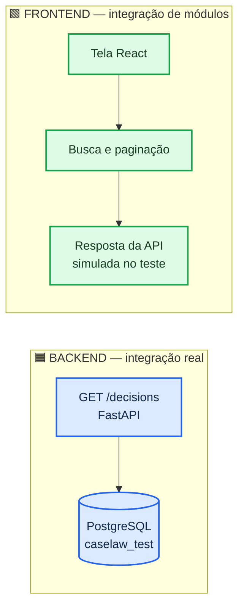
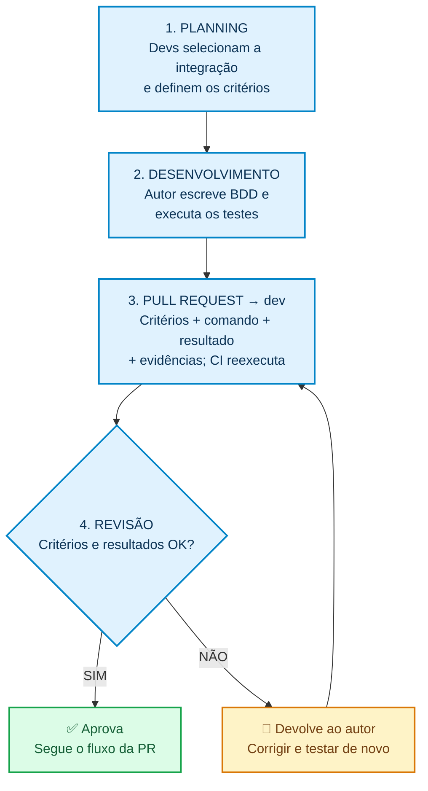

# 🧭 Guia visual — Testes de integração no Case-Law

> **Objetivo da conversa com o professor:** validar um **padrão mínimo que os desenvolvedores sigam**, usando exemplos reais do nosso projeto. **Não é um teste do sistema inteiro.**
>
> **Como apresentar:** mostre a seção ①, acompanhe o fluxograma ②, leia os dois critérios ③ e encerre com a pergunta ⑤.

## ① O que chamamos de “unidade de integração”?

| 🟦 BACKEND | 🟩 FRONTEND |
| :---: | :---: |
| **API FastAPI ↔ PostgreSQL real de teste** | **Tela React ↔ lógica de busca e paginação** |
| O banco é real, mas separado da aplicação de produção | A API é **simulada**: estamos testando os módulos do frontend juntos |
| **Exemplo:** filtrar decisões pelo tribunal STJ | **Exemplo:** mostrar os resultados e a paginação corretos |

**Resposta para “qual é a unidade?”** No teste de integração, nossa unidade de verificação é **uma interação delimitada entre partes do sistema**; não apenas uma classe.

## ② Padrão que os desenvolvedores devem seguir

**Quando?** Durante o desenvolvimento e antes de aprovar a PR. Se o autor corrigir algo, reexecuta e anexa nova evidência.

**Regra mínima:** só exigir teste de integração novo quando a alteração impactar a comunicação entre partes do sistema. Se não impactar, justificar brevemente na PR.

## ③ Critérios BDD concretos (do próprio Case-Law)

### 🟦 Backend — API + PostgreSQL

> **DADO** um banco de teste com decisões de diferentes tribunais.  
> **QUANDO** a API busca **“dano moral”**, filtrando **STJ**.  
> **ENTÃO** retorna **HTTP 200**, **total = 2** e somente as decisões **2000001** e **2000002**, ambas do STJ.

🧪 Teste existente: [`test_one_court_returns_only_its_decisions`](https://github.com/pablohgs05/Case-Law/blob/dev/backend/tests/test_search_filters.py). Usa `TestClient` e PostgreSQL real `caselaw_test`, com dados controlados.

### 🟩 Frontend — Tela + pesquisa e paginação

> **DADO** uma resposta **simulada** da API com **45 resultados**.  
> **QUANDO** o usuário clica em **Pesquisar**.  
> **ENTÃO** aparecem **6 cartões** e o texto **“Exibindo 1–6 de 45 resultados”**.

🧪 Teste existente: [`on the first page of 45 ...`](https://github.com/pablohgs05/Case-Law/blob/dev/frontend/src/tests/resultsPagination.test.tsx). Usa React Testing Library e Vitest; **não** sobe o backend.

## ④ Como provar que a parte técnica funciona?

| Evidência | Resultado confirmado no CI da `dev` |
| :--- | :--- |
| ✅ Backend | **532 testes passaram** — inclui os testes que usam PostgreSQL real |
| ✅ Frontend | **258 testes passaram** — inclui o cenário de 45 resultados e paginação |
| 🔗 Registro | [GitHub Actions — execução de 23/10/2026](https://github.com/pablohgs05/Case-Law/actions/runs/40036099848) |

*532 e 258 são os totais das suítes do projeto, não a quantidade de cenários deste guia. O padrão de revisão por toda a equipe é o que será validado com o professor.*

## ⑤ Fala pronta — aproximadamente 50 segundos 🎤

> **Professor, nossa proposta é que os testes de integração sigam um padrão simples da equipe.**  
> Na planning, os desenvolvedores identificam qual integração será afetada e definem os critérios. Durante o desenvolvimento, o autor implementa cenários Dado, Quando e Então e executa os testes. Depois registra os resultados na PR. O revisor confere: se estiver correto, segue; se não, devolve para correção e nova execução.  
> No Case-Law temos exemplos reais nos dois lados: **a API integrada ao PostgreSQL** no backend e **a tela integrada à lógica de busca e paginação** no frontend. Esses testes já existem e passam no CI.  
> **Podemos validar essas quatro etapas como o padrão mínimo para o time seguir?**

<strong>🙋 Se o professor interromper — respostas de 1 frase</strong>

| Pergunta | Resposta |
| :--- | :--- |
| **Qual é a unidade de integração?** | O par de partes que precisa funcionar junto: API + banco; tela + busca/paginação. |
| **Quem define os critérios?** | Os desenvolvedores na planning. |
| **Quais critérios?** | Backend: STJ → 2 decisões corretas. Frontend: 45 resultados → 6 cartões e paginação 1–6 de 45. |
| **Quando testa?** | Durante o desenvolvimento, antes da revisão da PR e depois das correções. |
| **Quem implementa e corrige?** | O autor da alteração; falhas anteriores ou de infraestrutura são encaminhadas ao responsável. |
| **Quem aprova?** | O revisor, após conferir critérios, código e evidências; CI verde não substitui essa revisão. |
| **Por que não é teste unitário?** | Porque verifica partes funcionando juntas, em vez de uma classe ou componente isolado. |
| **A API é real no frontend?** | Não: sua resposta é simulada. A integração coberta ali é entre módulos da interface. |
| **Já está sendo aplicado?** | Os exemplos técnicos já existem e passam no CI do fork; estamos validando o uso deste ciclo como padrão da equipe. |

---

📘 **Documentação detalhada:** [Padrão de testes de integração](https://github.com/pablohgs05/Case-Law/blob/dev/documentation/testing/wiki-preparada/Padrao-de-testes-de-integracao.md) · [CI do projeto](https://github.com/pablohgs05/Case-Law/blob/dev/.github/workflows/ci.yml)

*Material de apresentação e validação do processo. Não altera código, CI, ReqTrack ou o repositório original.*
