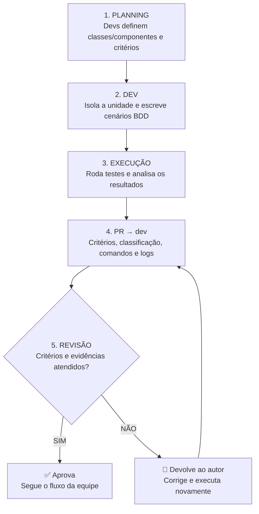
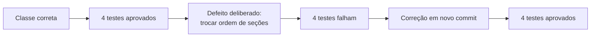

# 🧭 Guia visual — Testes unitários no Case-Law

> **Objetivo:** mostrar o fluxo validado conceitualmente com o professor e as evidências técnicas já executadas no projeto. A apresentação unitária é separada da validação dos testes de integração.

## ① Qual é a unidade testada?

| 🟦 Backend | 🟩 Frontend |
| :--- | :--- |
| **Classes**, com prioridade para **regra de negócio, services e utilitárias** | **Componentes React** |
| Exemplo: `StructuredEmenta.rebuild` | Exemplo: `DecisionResultCard` |
| Recebe dados em memória, sem banco/rede | Recebe props controladas, sem backend real |

Uma classe é a unidade escolhida para o backend; o teste verifica o **comportamento observável** de seus métodos. No frontend, o componente é renderizado isoladamente.

## ② Processo de testes unitários

**Responsabilidade:** se a PR introduzir falha ou conflito de teste, quem abriu a PR deve investigar, corrigir, reexecutar e registrar o novo resultado. Erro de infraestrutura ou defeito preexistente deve ser encaminhado ao responsável.

## ③ Critérios BDD do próprio projeto

### 🟦 Backend — `StructuredEmenta.rebuild`

**DADO** cabeçalho e quatro seções com textos distintos.  
**QUANDO** a classe reconstrói a ementa.  
**ENTÃO** preserva integralmente os caracteres e a ordem correta.  

Também são cobertos texto vazio, acentos, quebras de linha e espaços.

🧪 [Código com quatro testes focais](https://github.com/pablohgs05/Case-Law/blob/dev/backend/tests/test_scrum_ementa_bdd.py)

### 🟩 Frontend — `DecisionResultCard`

**DADO** uma decisão com trecho vazio, só espaços ou quebra de linha.  
**QUANDO** o componente é renderizado.  
**ENTÃO** mostra “Trecho indisponível.” e mantém tribunal e processo identificáveis.

🧪 [Código com três testes focais](https://github.com/pablohgs05/Case-Law/blob/dev/frontend/src/tests/scrumCardBdd.test.tsx)

## ④ Prova de que os testes detectam defeitos

- [PR #3 — sandbox, não integrar](https://github.com/pablohgs05/Case-Law/pull/3): defeito no commit `ed77944`, correção em `a65f469`, testes mantidos.
- [PR #2 — contribuição unitária integrada à `dev`](https://github.com/pablohgs05/Case-Law/pull/2): código, critérios e evidências em PR, CI concluído e merge registrado.
- [CI da `dev` após atualização de 05/11/2026](https://github.com/pablohgs05/Case-Law/actions/runs/42039148107): verificar o status atualizado antes de apresentar.

As quatro falhas foram **provocadas no sandbox** para demonstrar que os testes detectam a quebra de regra. Não são uma aprovação ou devolução feita por outro desenvolvedor.

## ⑤ Fala curta para apresentar

> Professor, como combinamos, no backend priorizamos classes de regra de negócio, service e utilitárias, e no frontend testamos componentes. Os critérios e unidades são escolhidos na planning. O dev isola a unidade, descreve o comportamento em Dado, Quando e Então e executa os testes. Na PR registra critérios, comandos e resultados. A revisão confere tudo: se atende, segue o fluxo; se falhar, devolve ao autor para corrigir, reexecutar e obter nova revisão. No Case-Law mostramos isso tecnicamente com a classe de ementa e o cartão de decisão. Também inserimos um defeito proposital que fez quatro testes falharem; corrigimos em outro commit, e os mesmos quatro passaram.

## ⑥ Respostas rápidas

| Pergunta | Resposta |
| :--- | :--- |
| **Qual unidade?** | Backend: classe, priorizando regra de negócio/service/utilitária; frontend: componente. |
| **Quando decidir?** | Na planning, com os desenvolvedores. |
| **Por que BDD?** | Para tornar o comportamento esperado verificável em Dado, Quando e Então. |
| **Quem corrige falha introduzida pela PR?** | O autor da PR, com novos testes e evidências. |
| **O teste verde aprova a PR sozinho?** | Não; revisão e critérios da equipe também contam. |
| **Onde está o resultado concreto?** | PR #2, PR #3, logs de falha/correção e CI do GitHub. |

📘 [Roteiro detalhado](https://github.com/pablohgs05/Case-Law/blob/dev/documentation/testing/APRESENTACAO.md) · [Guia visual de integração](https://github.com/pablohgs05/Case-Law/blob/dev/documentation/testing/wiki-preparada/Guia-visual-integracao.md)
